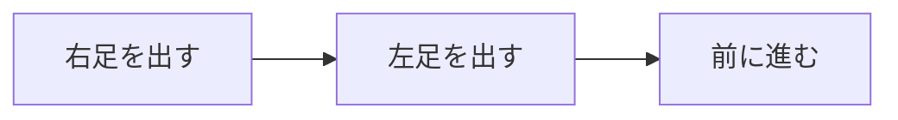

# ハンドドリップのすゝめ

みなさん，Claude CodeやCodexなどのコーディングAIを使用していますよね？
それらの待ち時間には何をしているでしょうか？スマホを見ている？Twitter (現X) を開いている？
これらから得られるドーパミンと快楽は人間には少なすぎます．

そこで私が進めるのがハンドドリップコーヒーです．

## 目次
[[toc]]

## どうして待ち時間にハンドドリップがおすすめなの？

まずハンドドリップでコーヒーを入れるのには最低5分かかるためAIの待ち時間にちょうど良いです．
また，机の前から離れる必要があり疲れた頭をリセットすることができます．

そして何より重要なのが美味しいコーヒーが生成されるからです．
個人的には，他のどんな方法で飲むコーヒーよりもハンドドリップコーヒーが美味しいと思っています．

コーヒーの香りが部屋に広がるという点も無視できません．
コーヒー豆を挽いてそれを抽出した後に部屋に広がる香りは，言葉に表せないほど良いものです．

## ハンドドリップって何？

現代にはコーヒーを飲む手段が数多く存在します．

- インスタントコーヒー
- 缶コーヒー・ペットボトルコーヒー
- コーヒーメーカー
- コンビニコーヒー
- ハンドドリップコーヒー

これらは大きく，コーヒーになった状態で売られているもの．粉を溶かすもの．フィルターを使い抽出するもの．に分けられます．
この ”抽出” を ”ドリップ” といいます．そのため，「抽出を手で行う」これをハンドドリップといいます．

## 豆をゴリゴリ挽いている人がいるけどあれは何？

本来ハンドドリップという言葉には

## Hint コンテナ

カードっぽいやつ\
::: tip ヒント
ヒント
:::

::: warning 警告
警告
:::

::: danger 危険
危険な警告
:::

::: info 情報
情報
:::

::: important 重要
重要なメッセージ
:::

::: note ノート
ノート
:::

タイトル省略（デフォルトタイトル）：

::: tip
This is a tip
:::

折りたたみ：

::: details クリックして展開
隠れている内容

```ts
console.log('Hello, VuePress!')
```

:::

## 絵文字

VuePress 2 is out :tada: !

## コードブロック

通常：
```rust
fn main() {
    println!("Hello, World");
}
```

タイトル付き：
```rust title="main.rs"
fn main() {
    println!("Hello, World");
}
```

行ハイライト：
```rust{1,3}
fn main() {
    println!("Hello, World");
}
```

行ハイライト（範囲・複数）：
```rust{1,3-4}
fn main() {
    let a = 1;
    let b = 2;
    println!("{}", a + b);
}
```

行番号強制ON
```rust:line-numbers
fn main() {
    println!("Hello, World");
}
```

行番号強制OFF
```rust:no-line-numbers
fn main() {
    println!("Hello, World");
}
```

組み合わせ
```rust title="a.rs" {1} :no-line-numbers
fn main() {
    println!("Hello, World");
}
```

v-pre（デフォルトで有効なので `{{ }}` はそのまま表示される）：
```md
1 + 2 + 3 = {{ 1 + 2 + 3 }}
```

v-pre を無効化（Vue に評価させる）：
```md:no-v-pre
1 + 2 + 3 = {{ 1 + 2 + 3 }}
```

## コードのインポート

別ファイルのコードを取り込む構文（書式の例。実際に使うときは ``` の外に書く）：

```md
@[code](../foo.rs)
@[code{1-10}](../foo.rs)
@[code rust](../foo.rs)
@[code rust{2,4-5}](../foo.rs)
@[code{3-10} rust{3}:no-line-numbers](../foo.rs)
```

## コードタブ

::: code-tabs

@tab Rust

```rust
fn main() {
    println!("Hello, World");
}
```

@tab Python

```python
print("Hello, World")
```

:::

## タブ

::: tabs

@tab 読む

記事を読んで、基本的な考え方を学びます。

@tab 試す

コードをコピーして実行し、自分の環境で確かめます。

:::

## Vue in Markdown

テンプレート構文：1 + 1 = {{ 1 + 1 }}

<span v-for="i in 3"> span: {{ i }} </span>

コンポーネント：<Badge text="demo" /> <Badge text="警告" type="warning" /> <Badge text="危険" type="danger" />

## 数式

$$
a^2 + b^2 = c^2
$$

インライン数式：$E = mc^2$

## 図（Mermaid）



## 動くコードの例

::: normal-demo クリックして試す

```html
<button onclick="this.textContent = '試せました！'">クリックしてください</button>
```

:::
